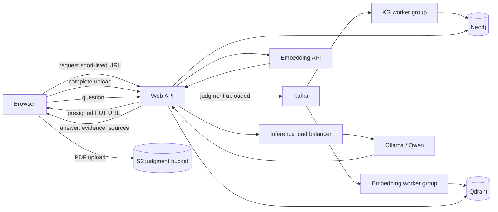

# QuestaCase Web API

Stateless Node.js API for the Firebase-hosted QuestaCase frontend. It runs as a
separate container from Kafka, even when both containers share one EC2 instance.

## Responsibilities

- Generate short-lived S3 `PUT` URLs for judgment PDFs.
- Verify completed S3 uploads before publishing `judgment.uploaded` to Kafka.
- Embed user questions with the same model used for stored chunks.
- Retrieve page-grounded chunks from Qdrant.
- Enrich retrieval with Neo4j relationships when available.
- Ask Ollama/Qwen for an evidence-bounded answer with page citations.

The browser never receives AWS credentials, Kafka credentials, Neo4j credentials,
or Qdrant API keys.

## Request and processing flow



The upload request returns before background processing finishes. The KG and
embedding groups consume the same upload topic independently and populate their
own stores. Query-time retrieval reads those stores and asks the inference
service to answer from the selected evidence.

## API routes

With the default `API_BASE_PATH=api/v1`:

```text
GET  /api/v1/health
POST /api/v1/uploads/presign
POST /api/v1/judgments
POST /api/v1/query
```

The request and response contracts match the frontend documentation in
`../webapp/README.md`.

Query all indexed judgments, or limit retrieval by supplying document IDs:

```json
POST /api/v1/query
{
  "question": "What did the Supreme Court hold and why?",
  "judgmentIds": [],
  "retrieval": {
    "vector": true,
    "graph": true
  }
}
```

The response contains the grounded `answer`, its ordered `sources`, and retrieval
counts for Qdrant chunks and Neo4j relationships. Set either retrieval flag to
`false` to run only the other evidence path. At least one flag must be enabled.
Omitting `retrieval` preserves the original behavior and enables both paths.
When both paths are enabled and `judgmentIds` is empty, the API uses Qdrant's
matching `document_id` values to constrain the corresponding Neo4j search.

With graph retrieval on, the API also looks up other uploaded judgments that
cite the cases behind the answer (needs kg_worker's cross-document graph). Their
treatment (followed, distinguished, ...) is added to the evidence. When an
uploaded judgment overrules one of those cases, the response has a `warnings`
entry (`caseLabel`, `overruledBy`, `documentId`, `page`, `evidence`) and
that source is always included. `retrieval.citingJudgments` counts these
results. Run `npm test` (or `node --test`) for the unit tests.

Each source carries `page` and `evidence` (the chunk text or the exact quote
behind a graph fact) when known, and `pdfUrl`, a GET link to the judgment PDF
that expires after `S3_PRESIGN_SECONDS`, when S3 is configured. Add
`#page=N` to open it at the cited page. The bucket's CORS rules do not apply to
plain navigation, but the EC2 role needs `s3:GetObject` on the judgment prefix.

These flags affect query-time retrieval only. Every uploaded judgment continues
to be processed independently by both the embedding and KG worker groups.

## Build and run

No host npm installation is needed because dependencies are installed inside the
image during the Docker build.

```bash
./build.sh
./run.sh
```

On its first invocation, `run.sh` creates `.env` from `.env.example` and stops.
Edit that private file, then run the script again.

The default image platform is `linux/amd64` for ordinary AWS EC2 instances. For
an ARM-based Graviton instance:

```bash
DOCKER_PLATFORM=linux/arm64 ./build.sh
```

## Running beside Kafka

`run.sh` creates a private Docker network named `questacase`. If containers named
`legal-kafka`, `questacase-neo4j`, or `questacase-qdrant` are already running, it
connects them to that network with the aliases used in `.env.example`.

For services on other EC2 instances, replace the service URLs and Kafka broker in
`.env` with their private VPC DNS names. Security groups should allow:

- Internet to the API only through HTTPS port 443.
- API and workers to Kafka port 9092 or its configured private listener.
- API to Qdrant, Neo4j, the embedding service, and inference only over the VPC.

Do not expose Kafka, Neo4j, Qdrant, Ollama, or the API's port 8080 directly to the
public internet. Put a TLS reverse proxy or load balancer in front of the API.

## S3 permissions

Attach an IAM role to the EC2 instance. The API needs narrowly scoped
`s3:PutObject` and `s3:GetObject` permissions on the configured judgment prefix
(`HeadObject` authorization is evaluated as object read access). The bucket CORS
policy must permit `PUT` from the two
Firebase domains; use `../webapp/s3-cors.example.json` as a starting point.

Use `s3-access-policy.example.json` as the IAM policy for the EC2 instance role.
Replace `REPLACE_WITH_BUCKET_NAME`, and change `judgments/` if `S3_PREFIX` uses a
different value. This is an identity policy for the API role, not a public bucket
policy.

## Expected indexed data

The Qdrant collection defaults to `judgment_chunks`. Each point payload should
contain:

```json
{
  "document_id": "document UUID",
  "chunk_id": "stable chunk ID",
  "page": 4,
  "text": "page-grounded chunk text",
  "filename": "judgment.pdf",
  "case_name": "Case name",
  "graph_node_ids": ["optional-neo4j-node-id"]
}
```

The query embedding service must expose the configured `EMBEDDING_API_URL`, accept
`{"model":"BAAI/bge-small-en-v1.5","text":"..."}`, and return either
`{"embedding":[...]}` or `{"vector":[...]}`. The model and vector dimension must
match the indexed judgment embeddings. The embedding worker image includes this
service at `/app/embedding_server.py`; run it on port 8081 with:

```bash
docker run --rm -p 8081:8081 \
  --entrypoint python legal-embedding-worker:latest \
  /app/embedding_server.py
```

Neo4j enrichment expects imported nodes to carry `id` and `document_id`
properties. If Neo4j is unavailable and `NEO4J_REQUIRED=false`, queries continue
using vector evidence only.

## Limitations for the demo

- Repeating `POST /judgments` can publish a duplicate Kafka event. Workers must be
  idempotent using `documentId` as the message key.
- Presigned `PUT` uploads are verified with S3 metadata after upload. The API
  rejects size, content-type, and ETag mismatches before publishing Kafka work.
- The API is stateless; chat history remains in the browser.
